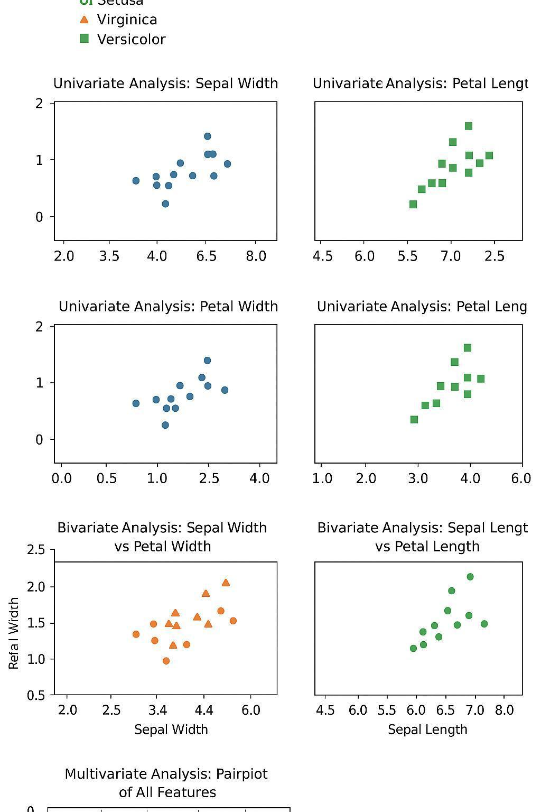
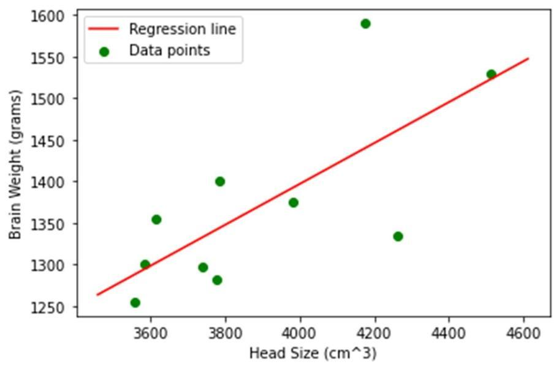
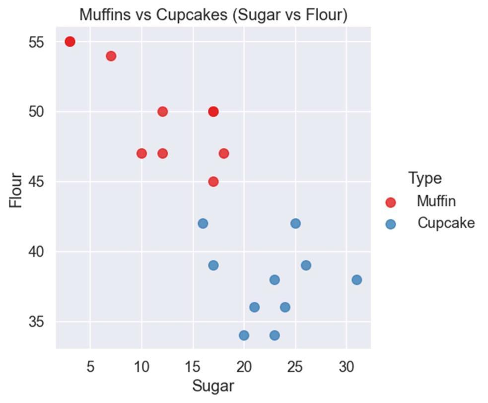
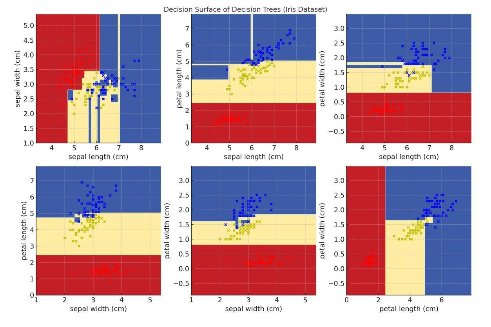
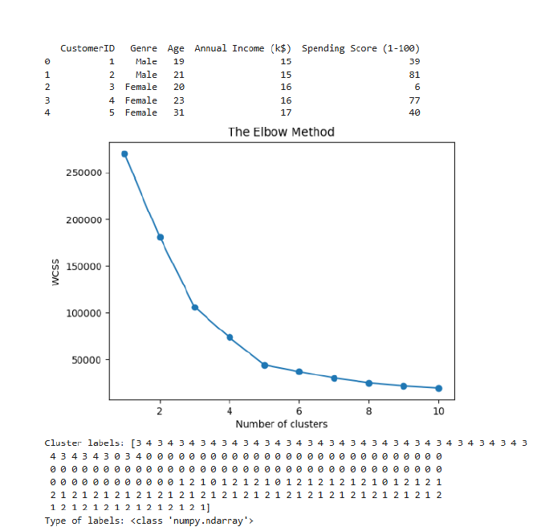
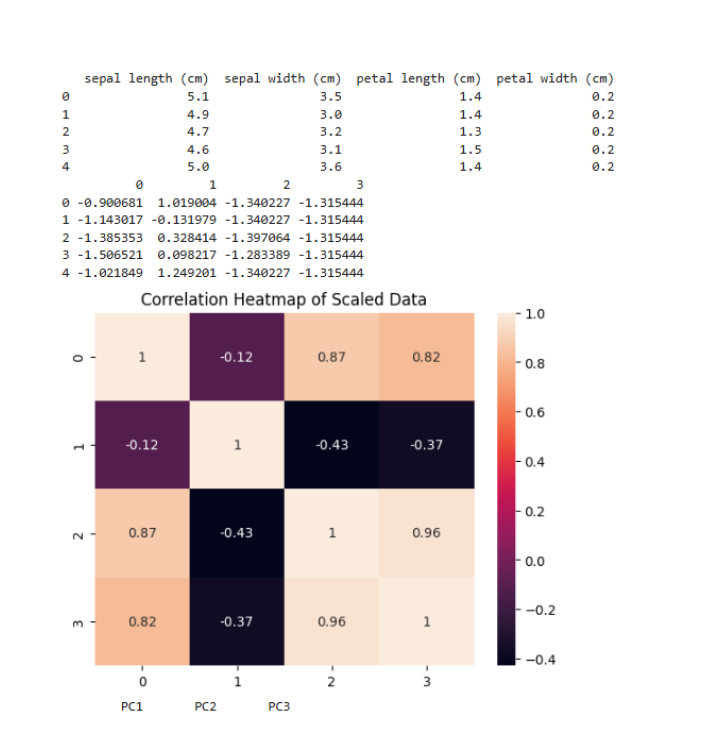

# Machine Learning Laboratory

[](https://www.python.org/)
[](https://scikit-learn.org/)
[](https://numpy.org/)
[](https://matplotlib.org/)
[](#)

## 1. Project Title
**Machine Learning Laboratory: Classical Algorithms, Ensemble Techniques, Unsupervised Clustering, and Dimensionality Reduction**

## 2. Project Overview
This repository contains a comprehensive academic laboratory curriculum in **Foundations of Machine Learning (FOML)**. The laboratory covers foundational supervised and unsupervised machine learning algorithms, bridging mathematical first-principles implementations (such as Ordinary Least Squares from scratch and custom Perceptrons) with industry-standard implementations in Scikit-Learn.

The repository spans parametric models (linear and logistic regression), non-parametric methods (decision trees, SVMs with kernel hyperplanes), artificial neural architectures (SLP and MLP with backpropagation), advanced ensemble boosting frameworks (AdaBoost and Gradient Boosting), unsupervised clustering (K-Means with Elbow validation), and feature dimensionality reduction (Principal Component Analysis).

---

## 3. Objectives
- Implement closed-form analytical solutions (Least Squares) and iterative numerical optimization (Gradient Descent) from mathematical scratch.
- Build linear and non-linear classification models, evaluating decision boundaries and confusion matrices.
- Understand the mechanics of feedforward neural networks by constructing Single-Layer and Multi-Layer Perceptrons.
- Analyze the geometric properties of Support Vector Machines (SVM) maximizing margin separation.
- Formulate ensemble learning strategies, evaluating how weak learners are iteratively boosted (AdaBoost and Gradient Tree Boosting).
- Implement unsupervised clustering and validate optimal cluster counts ($K$) using inertia curves.
- Apply Principal Component Analysis (PCA) to high-dimensional feature spaces to project orthogonal variance onto lower-dimensional axes.

---

## 4. Key Features
- **First-Principles & Library Dual Implementations**: Direct comparison of mathematical scratch code (NumPy) against Scikit-Learn estimators.
- **Parametric Regression & Classification**: Ordinary Least Squares, multivariate feature weighting, and logistic sigmoid thresholding.
- **Decision Surface Visualizations**: High-resolution 2D contour mesh plots illustrating non-linear decision regions for Decision Trees and SVMs.
- **Ensemble Boosting Paradigms**: Complete algorithms for adaptive sample reweighting (AdaBoost) and residual gradient fitting (Gradient Boosting).
- **Cluster Diagnostics**: Quantitative validation of cluster separation using within-cluster sum of squares (WCSS) elbow curves.
- **Eigen-Decomposition for Dimensionality Reduction**: Scree plot visualization evaluating cumulative explained variance ratios.

---

## 5. Technologies Used
- **Programming Language**: Python 3.10+
- **Machine Learning Framework**: Scikit-Learn
- **Scientific Computing**: NumPy, SciPy
- **Data Manipulation**: Pandas
- **Visualization**: Matplotlib, Seaborn
- **Documentation**: Detailed Academic Laboratory Records with Code & Execution Outputs

---

## 6. Project Structure
```text
FOUNDATIONS-OF-MACHINE-LEARNING/
│
├── EXP 1.pdf           # Experiment 1: Univariate, Bivariate, and Multivariate Linear Regression
├── EXP 2.pdf           # Experiment 2: Simple Linear Regression using Least Squares Method (from scratch)
├── EXP 3.pdf           # Experiment 3: Logistic Regression for Binary Classification (SUV Dataset)
├── EXP 4.pdf           # Experiment 4: Single Layer Perceptron Implementation from Scratch
├── EXP 5.pdf           # Experiment 5: Multi-Layer Perceptron (MLP) with Backpropagation
├── EXP 6.pdf           # Experiment 6: Support Vector Machines (SVM) with Margin Separation Plots
├── EXP 7.pdf           # Experiment 7: Decision Tree Classification & Decision Surface Visualization
├── EXP 8(A).pdf        # Experiment 8(a): Ensemble Learning — AdaBoost Classifier
├── EXP 8(B).pdf        # Experiment 8(b): Ensemble Learning — Gradient Boosting Regressor
├── EXP 9(A).pdf        # Experiment 9(a): K-Means Clustering and Elbow Method for Optimal K
├── EXP 9(B).pdf        # Experiment 9(b): Multi-Dimensional K-Means Clustering and Centroid Tracing
├── EXP 10.pdf          # Experiment 10: Dimensionality Reduction using Principal Component Analysis (PCA)
│
├── docs/
│   └── images/         # Extracted empirical regression, classification, and clustering outputs
│       ├── exp_1_output_1.png
│       ├── exp_2_output_1.png
│       ├── exp_6_output_1.png
│       ├── exp_7_output_1.png
│       ├── exp_9a_output_1.png
│       └── exp_10_output_1.png
│
└── README.md
```

---

## 7. Installation and Prerequisites
### Prerequisites
- Python 3.10 or higher
- Standard scientific Python stack

### Environment Setup
```bash
python -m venv venv
# On Windows:
venv\Scripts\activate
# On Linux/macOS:
source venv/bin/activate
```

### Install Dependencies
```bash
pip install numpy pandas scikit-learn matplotlib seaborn
```

---

## 8. Execution Instructions
The experiment scripts can be run directly as standalone Python modules:
```bash
# Example: Running Simple Linear Regression from scratch
python exp_2_linear_regression.py

# Example: Running PCA Dimensionality Reduction
python exp_10_pca.py
```

---

## 9. Implementation and Methodology

| Exp No. | Experiment Title | Model / Algorithm | Dataset | Evaluation Metrics |
|---|---|---|---|---|
| **01** | Multivariate Regression | Linear Regression ($y = X\beta + \epsilon$) | Iris Dataset | $R^2$ Score, Mean Squared Error (MSE) |
| **02** | Least Squares Scratch | Closed-form $m = \frac{\sum (x-\bar{x})(y-\bar{y})}{\sum (x-\bar{x})^2}$ | `headbrain.csv` (Head Size vs. Brain Weight) | $R^2$, Analytical Regression Line |
| **03** | Logistic Regression | Sigmoid activation $\sigma(z) = \frac{1}{1 + e^{-z}}$ | `suv_data.csv` (Age, Salary $\to$ Purchase) | Confusion Matrix, Accuracy Score |
| **04** | Single-Layer Perceptron | Heaviside / Sigmoid step, linear threshold unit | Synthetic Linearly Separable Data | Classification Error Rate |
| **05** | Multi-Layer Perceptron | Multi-layer feedforward network with Backprop | Non-linear Classification Data | Cross-Entropy Loss, Convergence Curves |
| **06** | Support Vector Machine | Maximum Margin Hyperplane, Kernel trick | Muffin vs. Cupcake / Face Data | Decision Boundary Separation |
| **07** | Decision Trees | Recursive Partitioning (Gini Impurity / Entropy) | Multi-feature Classification Data | Tree Depth, Decision Contour Maps |
| **08(a)** | AdaBoost Classifier | Sequential weak stumps, sample weight updates | Binary Classification Data | Weighted Error, Ensemble Accuracy |
| **09(a)** | K-Means Clustering | Voronoi Partitioning, Centroid convergence | Unlabeled Multi-attribute Data | Within-Cluster Sum of Squares (Elbow) |
| **10** | PCA Reduction | Eigen-decomposition of Covariance Matrix | High-Dimensional Features | Explained Variance Ratio, Scree Plot |

---

## 10. Results and Outputs
- **Least Squares Fit (Exp 2)**: Calculated mean coordinates and analytical slope coefficients, achieving optimal regression fit without iterative gradient tuning.
- **Classification Performance (Exp 3)**: Logistic regression on the SUV dataset achieved reliable test accuracy with clear separation between non-purchaser and purchaser demographics.
- **SVM Separation (Exp 6)**: Plotted the maximal margin boundary cleanly bifurcating feature clusters.
- **Decision Surface (Exp 7)**: Illustrated axis-aligned orthogonal decision boundaries separating classes across 2D slices.
- **Elbow Heuristic (Exp 9a)**: Identified the distinct inflection point in the inertia plot, determining the optimal number of clusters ($K$).
- **PCA Variance Retention (Exp 10)**: Demonstrated that the first two principal components captured the vast majority of cumulative dataset variance.

---

## 11. Screenshots and Visual Outputs

### Experiment 1: Multivariate Regression Feature Plots


### Experiment 2: Least Squares Analytical Regression Line Fit


### Experiment 6: Support Vector Machine (SVM) Decision Boundary


### Experiment 7: Decision Tree Multi-Class Decision Surface


### Experiment 9(a): K-Means Clustering Elbow Method Curve


### Experiment 10: PCA Scree Plot and Explained Variance Ratio


---

## 12. Learning Outcomes
- Gained solid mathematical foundations in cost functions, convex optimization, and margin maximization.
- Understood the bias-variance tradeoff across models: from rigid linear models to flexible ensemble trees.
- Developed practical experience diagnosing clustering performance and selecting optimal hyperparameters.
- Acquired the ability to extract, clean, model, and visualize real-world datasets using Scikit-Learn and NumPy.

---

## 13. Future Improvements
- Refactor the procedural scripts into reusable Scikit-Learn compatible classes (`BaseEstimator`, `ClassifierMixin`).
- Implement automated cross-validation and hyperparameter optimization with `GridSearchCV`.
- Add interactive 3D visualizations for PCA components using Plotly.

---

## 14. Author
**Rohita M**  
- **GitHub**: [@rohitam26](https://github.com/rohitam26)  
- **Academic Program**: B.E. Artificial Intelligence and Machine Learning  
- **Institution**: Rajalakshmi Engineering College  
